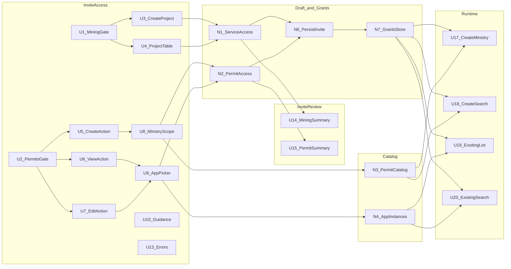

# Detail A — Breadboard: Invite CDPS permissions

Parent: [invite-cdps-permissions.md](./invite-cdps-permissions.md)

Affordances tables are the source of truth; Mermaid diagram renders them.

## Places

| Place | Description |
|-------|-------------|
| **InviteAccess** | Invite wizard access step (after role), when invitee is not Secondary Admin |
| **InviteReview** | Invite review & confirm step |
| **RuntimeCreate** | Post-login CDPS “start / create application” browse |
| **RuntimeExisting** | Post-login CDPS existing applications list/browse |
| **Catalog** | Non-UI: ministry / permit-type / application-instance data |

---

## UI Affordances

| ID | Affordance | Place | Wires Out |
|----|------------|-------|-----------|
| U1 | Domain gate: Mining Projects (opt-in) | InviteAccess | → N1, U3 |
| U2 | Domain gate: Permit Applications (opt-in) | InviteAccess | → N2, U5–U7 |
| U3 | Mining create-project Yes/No | InviteAccess | → N1 |
| U4 | Mining project permissions table + project search | InviteAccess | → N1 |
| U5 | Action gate: Create New | InviteAccess | → U8 |
| U6 | Action gate: View existing | InviteAccess | → U9 |
| U7 | Action gate: Edit existing | InviteAccess | → U9 |
| U8 | Create scope: per-ministry All \| Selected + permit-type search/picker | InviteAccess | → N2, N3 |
| U9 | Existing applications multi-select + search (name / number / ministry) | InviteAccess | → N2, N4 |
| U10 | Guidance alert: mining managed under Mining Projects | InviteAccess | — |
| U11 | Empty eligible permits message / CTA | InviteAccess | → N3 |
| U12 | Empty existing applications message | InviteAccess | → N4 |
| U13 | Error summary + field errors on Next | InviteAccess | → N5 |
| U14 | Review summary: Mining (if on) | InviteReview | → N1 |
| U15 | Review summary: Permit Create / View / Edit scopes (if on) | InviteReview | → N2 |
| U16 | Change links back to InviteAccess domain sections | InviteReview | → U1–U9 |
| U17 | Create browse: ministry list | RuntimeCreate | → N2, N3 |
| U18 | Create browse: permit search within ministry / global | RuntimeCreate | → N2, N3 |
| U19 | Existing browse: list filtered by View/Edit grants | RuntimeExisting | → N2, N4 |
| U20 | Existing browse: search by name / number / ministry | RuntimeExisting | → N2, N4 |

---

## Non-UI Affordances

| ID | Affordance | Place | Wires Out |
|----|------------|-------|-----------|
| N1 | Invite draft `ServiceAccess` (mining) | InviteAccess | → N6 |
| N2 | Invite draft `permitApplicationAccess` (create ministries/types; view/edit application ids) | InviteAccess | → N6 |
| N3 | Ministry + permit-type catalog (org-eligible, RBAC org-based only) | Catalog | → U8, U17, U18 |
| N4 | Existing application instances for org profile (draft + submitted) | Catalog | → U9, U19, U20 |
| N5 | Step validators (domain/action on ⇒ at least one grant) | InviteAccess | → U13 |
| N6 | Persist invite payload on send (role + mining + permit scopes) | InviteReview | → N7 |
| N7 | Session/user grants store used by runtime filters | RuntimeCreate / RuntimeExisting | → U17–U20 |
| N8 | Role skip: Secondary Admin invitee bypasses InviteAccess | InviteAccess | → InviteReview |

---

## Wiring (by Place)

---

## Progressive disclosure rules (wiring constraints)

1. **U3–U4** render only if **U1** on.
2. **U5–U7** render only if **U2** on.
3. **U8** renders only if **U5** on.
4. **U9** renders if **U6** or **U7** on (shared picker; grants tagged view vs edit).
5. **U14** / **U15** omit empty domains.
6. **N8**: if invitee role is Secondary Admin, skip InviteAccess → Review (no U1–U13).

---

## Scenario mapping

| Scenario | Affordances |
|----------|-------------|
| A — All MPBSDP create + two MOF create | U2, U5, U8 (MPBSDP=All, MOF=Selected) |
| B — Draft/submitted in profile | U6/U7, U9 over N4 (instances include draft + submitted) |
| C — Create browse by ministry / search permit | U17, U18 filtered by N2 create scope |
| D — Existing browse by name/number/ministry | U19, U20 filtered by N2 view/edit grants |
