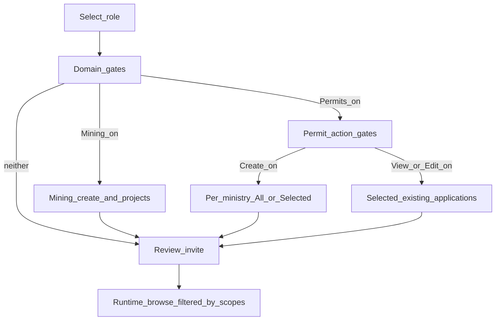

# Invite CDPS permissions — Shaping

Related: [Frame](./invite-cdps-permissions-frame.md) · [Catalog spike](./spike-cdps-permission-catalogs.md)

## Requirements (R)

| ID | Requirement | Status |
|----|-------------|--------|
| **R0** | Admins can assign org CDPS permit permissions at invite so users only get access required for their responsibilities | Core goal |
| **R1** | Mining Projects and Permit Applications are separate permission domains; inviter can assign Mining only, Permits only, both, or neither (role may still apply) | Must-have |
| **R2** | When Mining Projects is opted in, the existing mining assignment flow remains unchanged (create-project + per-project View/Edit) | Must-have |
| **R3** | Permit Applications permissions | Must-have |
| R3.1 | Create New Permit Application, with All vs Selected **per ministry** (Scenario A) | Must-have |
| R3.2 | View existing and Edit existing target **application instances** in the org profile (draft or submitted), not only permit types (Scenario B) | Must-have |
| R3.3 | Only organization-based RBAC-eligible applications are listed; individual-facing journeys are out of scope | Must-have |
| R3.4 | If no eligible permits/applications are available, show an informational message and/or CTA | Must-have |
| **R4** | Permission UX must not force both domain trees when only one is needed (progressive disclosure) | Must-have |
| **R5** | Post-login create browse/search and existing-application browse/search honor assigned scopes (Scenarios C/D) | Must-have |
| **R6** | Existing roles continue: Admin, Secondary Admin, Representative (Delegate), Member | Must-have |
| **R7** | Mining must not be configurable under Permit Applications; UI guidance points mining to the Mining Projects domain | Must-have |
| **R8** | Secondary Admin **invitee** continues to skip granular access assignment (full access by role); Secondary Admin **inviter** uses the same domain gates as Admin | Must-have |

---

## CURRENT

Prototype invite (v3 mining path) today:

| Area | Behavior |
|------|----------|
| Roles | `secondary_admin` (skips access step), `delegate` (Representative), `member` |
| Data | `ServiceAccess`: sub-services `mining` / `construction` / `highways`; group `permits-licences.createProject`; per-project `none` \| `view` \| `view_edit` |
| UI | Single mining card: create-project Yes/No + project permissions table + search |
| Catalog | One group in `SERVICE_GROUPS`; no ministries, Other Permits, or application instances |
| Review | Mining project lines only; create-project not summarized |
| Runtime | No create/existing-application browse filtered by invite scopes |

Key files: `src/rbac/types.ts`, `src/rbac/services.ts`, `src/rbac/roles.ts`, `src/components/invite/steps/ServiceAccessMiningStep.tsx`, `InviteUserWizard.tsx`.

---

## A: Opt-in permission domains (Mining | Permit Applications)

Selected shape. Progressive disclosure: domain gates → action gates → scoped pickers; review and runtime only reflect opted-in scopes.

| Part | Mechanism | Flag |
|------|-----------|:----:|
| **A1** | Domain gate UI on invite access step: opt-in **Mining Projects** and/or **Permit Applications** (default both off) | |
| **A2** | Keep CURRENT mining panel behind Mining gate (create-project + project View/Edit table + search) | |
| **A3** | Permit Applications action gates: Create New, View existing, Edit existing (details only when on) | |
| **A4** | Create scope: ministry list with All vs Selected + permit-type picker/search within Selected | |
| **A5** | View/Edit scope: existing-application multi-select with search by name, number, ministry | |
| **A6** | Extend invite draft model: keep `ServiceAccess` for mining; add parallel `permitApplicationAccess` for create/view/edit scopes | |
| **A7** | Review + validation: when a domain or action is on, require at least one configured grant; sparse summary of opted-in only | |
| **A8** | Runtime create browse: ministry → permit search filtered by Create scope (Scenario C) | |
| **A9** | Runtime existing-app browse: filter by View/Edit application grants; search by name/number/ministry (Scenario D) | |
| **A10** | Empty eligible permits / empty applications informational states (and CTA where product defines one) | |
| **A11** | Page guidance: Mining Projects permissions are managed in Mining Projects, not under Permit Applications | |
| **A12** | Role rules: Secondary Admin invitee skips access step; Member/Representative see gates; inviter Admin/Secondary Admin always assign | |

---

## Fit Check: R × A

| Req | Requirement | Status | A |
|-----|-------------|--------|---|
| R0 | Admins can assign org CDPS permit permissions at invite so users only get access required for their responsibilities | Core goal | ✅ |
| R1 | Mining Projects and Permit Applications are separate permission domains; inviter can assign Mining only, Permits only, both, or neither (role may still apply) | Must-have | ✅ |
| R2 | When Mining Projects is opted in, the existing mining assignment flow remains unchanged (create-project + per-project View/Edit) | Must-have | ✅ |
| R3 | Permit Applications permissions (Create / View / Edit; per-ministry All vs Selected; instances; eligible-only; empty state) | Must-have | ✅ |
| R4 | Permission UX must not force both domain trees when only one is needed (progressive disclosure) | Must-have | ✅ |
| R5 | Post-login create browse/search and existing-application browse/search honor assigned scopes (Scenarios C/D) | Must-have | ✅ |
| R6 | Existing roles continue: Admin, Secondary Admin, Representative (Delegate), Member | Must-have | ✅ |
| R7 | Mining must not be configurable under Permit Applications; UI guidance points mining to the Mining Projects domain | Must-have | ✅ |
| R8 | Secondary Admin invitee continues to skip granular access assignment; Secondary Admin inviter uses the same domain gates as Admin | Must-have | ✅ |

**Notes:**
- A4–A5 / A8–A9 depend on ministry, permit-type, and application-instance catalogs — see [spike-cdps-permission-catalogs.md](./spike-cdps-permission-catalogs.md). Prototype may use mocks until APIs exist.
- R3 sub-requirements are covered by A3–A5 and A10 collectively.

---

## Detail A: Breadboard

See [invite-cdps-permissions-breadboard.md](./invite-cdps-permissions-breadboard.md) (UI/Non-UI affordances + wiring).

## Catalog spike

See [spike-cdps-permission-catalogs.md](./spike-cdps-permission-catalogs.md) (N3/N4 mocks and wiring steps).

---

## Decisions log

| Decision | Choice |
|----------|--------|
| C/D scope | Invite assignment **and** runtime create/existing browse |
| All vs Selected grain | **Per ministry** |
| Domain model | Mining Projects ≠ Permit Applications; independent opt-in |
| Overwhelm mitigation | Progressive disclosure: domain gates → action gates → scoped pickers |
| Secondary Admin invitee | Skip granular access (CURRENT); inviter sees gates |
| Domain gate default | Both domains **off** until opted in |
| Catalog approach (spike) | Mock `cdpsPermitCatalog` + application fixtures; shared getters for invite + runtime |
